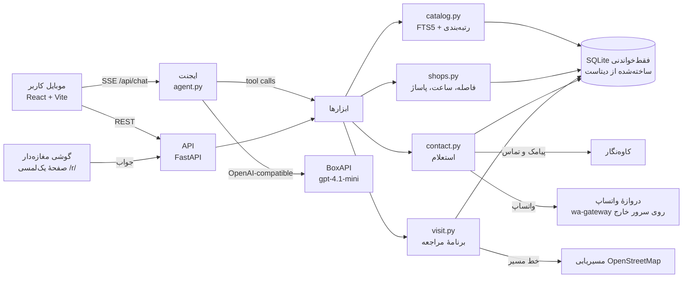

# تربچه: دستیار هوشمند خرید حضوری روی دادهٔ ترب

پروژهٔ چالش **ترب** در هکاتون Agentic AI استارکوچ (مهر ۱۴۰۵).

تربچه یک وب‌اپ موبایل‌محور، فارسی و راست‌به‌چپ است که کاربر را در هر چهار قدم خرید حضوری در تهران همراهی می‌کند. رابطش مثل نصب یک برنامه است: **هفت صفحه، هر صفحه یک سؤال**، با «قبلی» و یک دکمهٔ اصلی (رابط چتیِ قبلی هم با `?classic` در دسترس است).

1. **انتخاب کالا** («چی می‌خوای بخری؟»): نیاز را همان‌طور که به فروشنده می‌گویی می‌فهمد، اگر لازم باشد با چند گزینهٔ آماده سؤال می‌پرسد و از بین ۲۲۶ هزار کالای ترب با دلیل پیشنهاد می‌دهد.
2. **پیدا کردن فروشگاه‌های نزدیک** («کجا می‌خوای خرید کنی؟» و «چطوری می‌ری؟»): روی نقشه، با «نزدیک خودم»، جستجوی محله و پاساژ و مترو، یا لمس روی نقشه؛ محدوده با **دقیقهٔ راه** پیاده، با ماشین یا با مترو.
3. **مقایسهٔ فروشگاه‌ها**: قیمت ثبت‌شده و تازگی آن، زمان رسیدن، باز بودن **در زمان رسیدن کاربر**، قسطی، برآورد اصالت، پیشنهاد ارزان‌ترِ کمی دورتر، و مسیر داخل پاساژ.
4. **هماهنگی با فروشگاه**: از چند فروشگاه هم‌زمان می‌پرسد، هر مغازه از راه و به ترتیبی که خودش خواسته (واتساپ، پیامک، تماس خودکار)، جواب‌ها را زنده مثل یک گفت‌وگو نشان می‌دهد و مغازه‌دار با **یک لمس** روی صفحهٔ جواب می‌گوید موجود است یا نه و چقدر برای مشتری نگه می‌دارد. مشتری **کد رزرو** با شمارش معکوس می‌گیرد، و در آخر برنامهٔ مراجعه با **مسیر روی خیابان‌های واقعی** و مسیریابی با برنامهٔ نقشهٔ خود گوشی.

> شماره‌تلفن‌های دادهٔ هکاتون ساختگی‌اند؛ بنابراین جواب فروشگاه‌ها **شبیه‌سازی** می‌شود و این در رابط کاربری همه‌جا گفته شده. ولی **هر کسی می‌تواند خودش جای مغازه‌دار باشد**: در قدم «بپرسم؟» شمارهٔ موبایل خودش را می‌دهد و واتساپ، پیامک و تماس واقعی به گوشی خودش می‌آید و جوابش زنده در اپ می‌نشیند.

- نسخهٔ آنلاین: [bazargard-map.liara.run](https://bazargard-map.liara.run) (روی لیارا؛ با `?demo` می‌شود سناریوی جواب هر مغازه را برای ضبط ویدیو انتخاب کرد)
- کد: همین ریپو، با مجوز [MIT](LICENSE) (فقط برای کد؛ دیتاست، برند ترب و فونت ایران‌یکان مال صاحبانشان است و در ریپو نیستند). نسخهٔ اولیهٔ چتی: [github.com/ssepehrnoush/torob-bazargard](https://github.com/ssepehrnoush/torob-bazargard)
- ویدیوی دمو و سناریو: [VIDEO-SCRIPT.md](VIDEO-SCRIPT.md)
- یادداشت‌های کامل داده: [DATASET-NOTES.md](DATASET-NOTES.md)
- امنیت ایجنت (چک‌لیست کارگاه AI Governance): [SECURITY.md](SECURITY.md)

---

## چه چیزهایی در محصول هست

| نیاز (از ویدیوی چالش) | راه‌حل در تربچه |
|---|---|
| کاربر مدل مناسب را نمی‌داند | ایجنت اول جستجو می‌کند و سؤال‌هایش را از دادهٔ واقعی می‌سازد (برندهای موجود، بازه‌های قیمت واقعی، نوع کاربری)، بعد ۳ تا ۵ کالا با دلیل پیشنهاد می‌دهد. مقایسهٔ کنار‌به‌کنار مشخصات با «نظر دستیار». |
| فروشگاه‌های نزدیک | اول می‌پرسد چطور می‌روید (پیاده، ماشین شخصی، مترو و اتوبوس) و محدوده را با **زمان رسیدن** می‌گیرد («تا ۲۰ دقیقه»)، نه کیلومتر (کیلومتر در تنظیمات هست). زمان ماشین به ساعت روز و طول مسیر بستگی دارد و برای مقصد داخل طرح ترافیک هشدار می‌دهد. محله‌های آماده یا GPS، نقشه با برچسب قیمت. |
| مقایسهٔ قیمت، فاصله، ساعت کاری | «هزینهٔ کل» هر گزینه = قیمت + ارزش زمان رفت‌وآمد (هر دقیقه ۸٬۰۰۰ تومان) + جریمهٔ عدم قطعیت (ساعت نامعلوم، قیمت قدیمی). فروشگاه دورتر فقط وقتی بالاتر می‌آید که اختلاف قیمتش زمان اضافه را بیارزد، و دلیلش روی کارت نوشته می‌شود. سه حالت مرتب‌سازی. |
| قیمت ثبت‌شده قدیمی است | برچسب تازگی قیمت (اخیر / ممکن است تغییر کرده باشد / قدیمی) با تاریخ شمسی آخرین تغییر؛ «موجودی تأیید نشده» تا وقتی استعلام نشده؛ قیمت تأییدشده همیشه جدا نمایش داده می‌شود. |
| فروشنده جواب نمی‌دهد یا مغازه بسته است | برای هر فروشگاه بسته «جایگزین باز» نزدیک همان فروشگاه (حتی در همان پاساژ)؛ بعد از استعلام، جایگزین‌های آماده برای فروشگاه‌های ناموفق، کالای مشابه نزدیک، و فروشگاه‌هایی که «شاید داشته باشند». |
| مغازه را داخل پاساژ پیدا نمی‌کنم | استخراج پاساژ، طبقه و واحد از متن نشانی؛ راهنمای قدم‌به‌قدم، نمودار طبقات پاساژ، و **فروشگاه‌های هم‌طبقه با شمارهٔ واحد نزدیک به‌عنوان نشانه**. |
| فقط خرید قسطی | فیلتر «فقط قسطی» (ترب‌پی، اسنپ‌پی، دیجی‌پی، تارا، ازکی‌وام) که هم روی پیشنهاد کالا و هم روی فروشگاه‌ها اثر دارد و تعداد فروشگاه‌های پنهان‌شده را با دکمهٔ «نمایش همه» می‌گوید. |
| در محدوده چیزی نیست | پیشنهاد محدودهٔ بزرگ‌تر با تعداد فروشگاه هر پله («تا ۶۰ دقیقه: ۳۳ فروشگاه»)، و اگر یک گزینهٔ خوب بیرون محدوده باشد: «توی محدوده انتخابی شما مورد مناسبی پیدا نکردم، اما یه پیشنهاد خیلی خوب در فاصله دورتری دارم. مایلید بررسیش کنیم؟» |
| اصل یا غیراصل | ایجنت برای کالاهای برنددار می‌پرسد «فقط اورجینال یا غیراصل هم قبوله؟». برای هر پیشنهاد یک برآورد اصالت با درصد اطمینان و دلیل ساخته می‌شود (متن فروشنده مثل «کپی» یا «گارانتی شرکتی»، قیمت خیلی پایین‌تر از بقیه، ثبت گارانتی). در استعلام از خود فروشنده هم پرسیده می‌شود؛ اگر خودش بگوید کپی است برچسب «غیراصل» می‌خورد، وگرنه برآورد ما با دلیل‌ها نشان داده می‌شود. |
| مسیر با مترو و اتوبوس | مسیر شماتیک: پیاده تا ایستگاه، خط مترو و تعداد ایستگاه، تعویض خط، و تاکسی یا اتوبوس تا فروشگاه (ایستگاه‌ها از OpenStreetMap). |
| «حالا که تا اونجا می‌رم…» | «مسیر گردش و خرید»: یک دور پیادهٔ کوتاه در اطراف همان فروشگاه، از کنار کالاهای مرتبط (دسته‌هایی که فروشگاه‌های همین کالا معمولاً دارند) که قیمتشان زیر قیمت معمول همان کالا در ترب است. |
| زمان و شرایط مراجعه | انتخاب «همین الان / امروز عصر / فردا صبح / فردا عصر»؛ هشدار «تا برسید بسته می‌شود»، پنجشنبه‌ها و جمعه‌ها، ساعت نامعلوم. |
| تماس با مغازه از راهی که خودش می‌خواهد | هر مغازه ترتیب راه‌های تماسش را دارد (در محصول واقعی در پنل فروشندهٔ ترب انتخاب می‌کند). برای تست واقعی: واتساپ، بعد از ۲۰ ثانیه پیامک، بعد از ۲۰ ثانیهٔ دیگر تماس خودکار که می‌گوید لینک جواب فرستاده شد. هر وقت مغازه‌دار لینک را بزند، مرحله‌های بعد لغو می‌شوند؛ راهی که نرود (شماره واتساپ ندارد، سرویس قطع است) روی صفحه گفته می‌شود و راه بعدی فوراً می‌رود. |
| جواب مغازه‌دار بد فهمیده نشود | جواب تایپ نمی‌شود: صفحهٔ یک‌لمسی (`/r/<کد>`) با «موجوده، با همین قیمت»، «قیمتش عوض شده» (و عدد) یا «نداریم»، به‌علاوهٔ «براش نگه می‌داری؟ ۱ ساعت / ۲ ساعت / نه». شمارهٔ مشتری به مغازه‌دار نشان داده نمی‌شود. |
| رسیدم و مغازه نگه نداشته بود | **کد رزرو** ۴ رقمی که مغازه‌دار هم روی صفحهٔ خودش می‌بیند، با شمارش معکوس ثانیه‌ای در برنامهٔ مراجعه؛ اگر رزرو پیش از رسیدن تمام شود، قرمز می‌شود و هشدار می‌دهد. |
| منتظر جواب ماندن روی صفحه | استعلام مثل یک گفت‌وگو: «۲ از ۳ فروشگاه جواب دادن»، برای هر مغازه راه‌های امتحان‌شده و حباب جواب. اگر کاربر در برنامهٔ دیگری باشد، با رسیدن جواب گوشی می‌لرزد، اعلان می‌آید و عنوان تب «(۱) جواب رسید» می‌شود. |
| مسیر واقعی تا مغازه | خط مسیر روی خیابان‌های واقعی (پیاده یا ماشین با رعایت یک‌طرفه‌ها، از سرویس مسیریابی OpenStreetMap)؛ اگر سرویس جواب ندهد همان خط‌چین قبلی. دکمهٔ مسیریابی در اندروید فهرست «باز کردن با» خود گوشی را نشان می‌دهد (نشان، بلد، گوگل‌مپ یا هر برنامهٔ نصب‌شده) و اگر برنامه‌ای نباشد نقشهٔ وب را باز می‌کند. |
| رفتن به برنامهٔ دیگر و برگشتن | دکمهٔ برگشت گوشی یک قدم عقب می‌رود (نه بیرون از اپ)، و کالا، مغازه‌ها و جواب‌ها با رفرش یا بسته شدن تب در پس‌زمینه از دست نمی‌روند. |

ویژگی‌های دیگر: اشتراک برنامهٔ مراجعه، حالت سادهٔ بدون مدل زبانی (اگر LLM در دسترس نباشد اپ با جستجوی قاعده‌محور کار می‌کند)، صفحهٔ «تربچه چطور کار می‌کند» برای شفافیت داده. گفت‌وگوی صوتی ساخته و روی سایت زنده تست شد، ولی چون تلفظ فارسی مدل‌ها و سرعتشان به اندازهٔ کافی خوب نبود، فعلاً کنار گذاشته شده و اپ متنی است.

---

## معماری



- **بک‌اند**: Python 3.12، FastAPI، SQLite با FTS5 و R-Tree (فقط خواندنی، `immutable`)، httpx برای مدل زبانی. هیچ سرویس جانبی دیگری لازم نیست.
- **فرانت‌اند**: React 19 + TypeScript + Vite، بدون کتابخانهٔ UI؛ Leaflet برای نقشه (به‌صورت lazy)، فونت وزیرمتن داخل خود اپ (به CDN خارجی وابسته نیست).
- **یک ایمیج**: `Dockerfile` در مرحلهٔ اول دیتابیس را از زیپ خام دیتاست می‌سازد و در مرحلهٔ دوم API و فرانت ساخته‌شده را سرو می‌کند.

```
torob/
├── backend/
│   ├── app/
│   │   ├── main.py        # مسیرهای API و سرو فرانت
│   │   ├── agent.py       # حلقهٔ ایجنت، ابزارها، پرامپت، حالت بدون LLM
│   │   ├── catalog.py     # جستجوی کالا، تشخیص دستهٔ اصلی، مقایسه، کالای مشابه
│   │   ├── shops.py       # رتبه‌بندی فروشگاه، ساعت کاری، قسطی، راهنمای پاساژ، جایگزین باز
│   │   ├── contact.py     # پیش‌نویس پیام، استعلام هم‌زمان، صفحهٔ جواب یک‌لمسی، کد رزرو، جمع‌بندی
│   │   ├── kavenegar.py   # پیامک (الگو) و تماس خودکار واقعی، فقط به شمارهٔ تستر، با سقف روزانه
│   │   ├── whatsapp.py    # پیام واتساپ از دروازهٔ سازگار با WAHA
│   │   ├── visit.py       # ترتیب مراجعه، باز بودن در زمان رسیدن، هشدار تمام شدن رزرو
│   │   ├── streets.py     # خط مسیر روی خیابان‌های واقعی (OpenStreetMap)
│   │   ├── travel.py      # زمان پیاده/ماشین/مترو، مسیر شماتیک مترو، طرح ترافیک
│   │   ├── authenticity.py # برآورد اصل یا غیراصل با دلیل و درصد اطمینان
│   │   ├── stroll.py      # مسیر گردش و خرید در اطراف فروشگاه
│   │   ├── geo/tehran_metro.json  # ایستگاه‌های مترو تهران به ترتیب خط (OpenStreetMap)
│   │   ├── timegeo.py     # وقت تهران، ساعت کاری، فاصله، اعداد فارسی
│   │   ├── llm.py         # کلاینت مدل زبانی (BoxAPI)، سقف هزینه و حافظهٔ موقت
│   │   └── config.py      # تنظیمات از متغیرهای محیطی
│   ├── scripts/make_app_db.py   # نسخهٔ سبک دیتابیس برای دیپلوی
│   └── tests/test_core.py
├── data/build_db.py       # ساخت دیتابیس از CSV ها + نرمال‌سازی فارسی (مشترک با جستجو)
├── frontend/src/          # اپ React
├── deploy/deploy_liara.py # دیپلوی با API لیارا
├── deploy/wa-gateway/     # دروازهٔ واتساپ (Baileys) با nginx، روی سروری بیرون از ایران
├── Dockerfile, liara.json
└── DATASET-NOTES.md, VIDEO-SCRIPT.md
```

---

## ایجنت و ابزارها

هر پیام کاربر یک «نوبت» ایجنت است که به‌صورت SSE پخش می‌شود؛ کاربر قدم‌های ایجنت را زنده می‌بیند (مثلاً «جستجو در کاتالوگ ترب: «گوشی سامسونگ»، ۴۰۰ نتیجه»).

**پیش از مدل (قطعی و سریع):**
- ترجیحات واضح مستقیم از متن خوانده و اعمال می‌شوند: بودجه («تا ۲۵۰ میلیون»، «۳ تا ۵ میلیون»)، قسطی، محله، زمان مراجعه، وسیلهٔ رفت‌وآمد («با مترو میرم»)، محدودهٔ زمانی («تا ۳۰ دقیقه») و اصالت («فقط اورجینال»). این کار یک رفت‌وبرگشت مدل را حذف می‌کند.
- برای اولین درخواست، یک جستجوی اولیه با کلیدواژه‌های تمیزشده انجام و نتیجه‌اش به مدل داده می‌شود تا معمولاً در یک فراخوانی جواب بدهد.

**ابزارهای مدل** (`agent.py`):

| ابزار | کار | نوع |
|---|---|---|
| `search_products` | جستجوی FTS با فیلتر دسته/برند/بودجه؛ خروجی شامل تعداد فروشگاه در شعاع کاربر، فروشگاه قسطی، مشخصات کلیدی و facet ها | داده |
| `get_specs` | مشخصات کامل تا ۴ کالا برای مقایسه و دلیل‌آوری | داده |
| `find_shops` | رتبه‌بندی فروشگاه‌های یک کالا با هزینهٔ کل، برآورد اصالت، پیشنهاد دورتر و پله‌های محدودهٔ بزرگ‌تر، + کالای مشابه نزدیک اگر فروشگاه کم است | داده |
| `update_preferences` | تغییر بودجه، قسطی، محدوده (دقیقه یا کیلومتر)، وسیلهٔ رفت‌وآمد، اصالت، محل، زمان مراجعه (رابط کاربری هم‌زمان به‌روز می‌شود) | حالت |
| `ask_user` | سؤال با گزینهٔ آماده (حداکثر ۲ سؤال) | پایان نوبت |
| `show_products` | کارت کالا با دلیل و برچسب | پایان نوبت |
| `show_shops` | رفتن به صفحهٔ فروشگاه‌ها با گزینه‌های برجسته | پایان نوبت |
| `start_inquiry` | شروع استعلام از چند فروشگاه | پایان نوبت |
| `reply` | پاسخ کوتاه با پیشنهاد قدم بعد | پایان نوبت |

هر نوبت با یک ابزار نمایشی تمام می‌شود (`tool_choice=required`)، پس رابط کاربری همیشه کارت و دکمه دارد و کاربر کمتر تایپ می‌کند. شناسهٔ کالا/فروشگاهی که مدل بدهد و در داده نباشد دور ریخته می‌شود (ضد توهم). اعداد خروجی مدل به رقم فارسی با جداکنندهٔ هزارگان تبدیل می‌شوند.

**بخش‌های قطعی که مدل لازم ندارند**: فیلترها و مرتب‌سازی فروشگاه‌ها، جزئیات فروشگاه، راهنمای پاساژ، برنامهٔ مراجعه. مدل فقط جایی صدا زده می‌شود که ارزش افزوده دارد: فهم نیاز، دلیل پیشنهاد، «نظر دستیار» در مقایسه و صفحهٔ فروشگاه‌ها، و جمع‌بندی استعلام.

**استعلام (contact.py)**: پیام هر فروشگاه با قیمت ثبت‌شدهٔ خود آن فروشگاه نوشته و قبل از ارسال به کاربر نشان داده می‌شود. هر مغازه از راه‌های خودش و به ترتیب خودش پرسیده می‌شود و هر راهی که بی‌جواب بماند، راه بعدی امتحان می‌شود. جواب از صفحهٔ یک‌لمسی می‌آید، پس ساختاریافته است و تفسیر متن آزاد لازم ندارد؛ لمس واقعی روی آن صفحه همیشه بر شبیه‌سازی برنده است. پاسخ فروشگاه‌هایی که شمارهٔ واقعی ندارند از یک سناریوی تصادفیِ ثابت برای هر روز ساخته می‌شود که احتمال‌هایش به دادهٔ واقعی وابسته است: هرچه قیمت قدیمی‌تر، احتمال تغییر قیمت بیشتر؛ فروشگاهی که طبق ساعت ثبت‌شده الان بسته است جواب نمی‌دهد. با `?demo` در آدرس می‌شود سناریوی هر فروشگاه را برای ضبط ویدیو انتخاب کرد؛ سناریوی «زنده» منتظر لمس واقعی می‌ماند و کد QR صفحهٔ جواب را برای گوشی دوم نشان می‌دهد.

**پیامک، تماس و واتساپ واقعی**: فقط به شماره‌ای می‌رود که خود تستر در قدم «بپرسم؟» می‌دهد (یا شماره‌های دموی `DEMO_SHOP_PHONES`)، هرگز به شماره‌های دیتاست. ترمزها: فقط موبایل ایران، هر شماره روزی ۲ و هر مرورگر روزی ۳ استعلام واقعی، کل پیامک و تماس روزی ۳۰، و شماره در لاگ نوشته نمی‌شود. پیامک با الگوی تأییدشدهٔ کاوه‌نگار می‌رود و تماس خودکار متنی را می‌خواند (جواب تماس گرفته نمی‌شود؛ فقط خبر می‌دهد که لینک جواب فرستاده شد). APIِ رسمی واتساپ برای ایران بسته است و واتساپ از دیتاسنترهای داخل ایران هم فیلتر است، برای همین پیام واتساپ از یک دروازهٔ متن‌باز (Baileys) روی سروری بیرون از ایران می‌رود که به یک حساب معمولی واتساپ وصل است (`deploy/wa-gateway`).

**مدل زبانی**: همهٔ فراخوانی‌های هوش مصنوعی اپ از **BoxAPI** (درگاه اسپانسر هکاتون، سازگار با OpenAI و در دسترس از دیتاسنترهای ایران) با مدل `gpt-4.1-mini` انجام می‌شود؛ هم روی لیارا و هم در اجرای محلی (پیش‌فرض `LLM_PROVIDER=boxapi`). `gpt-4.1-mini` در آزمون چندنوبتی از `gpt-5.4-mini` پایدارتر بود. OpenAI مستقیم فقط اختیاری است و باید صریحاً با `LLM_PROVIDER=openai` روشن شود. اگر مدل در دسترس نباشد یا سقف هزینه پر شود، اپ با جستجوی قاعده‌محور ادامه می‌دهد.

---

## داده: چطور استفاده شده و محدودیت‌ها

ساخت: `data/build_db.py` سه CSV دیتاست (۶٬۴۷۶ فروشگاه، ۲۲۵٬۹۰۳ کالا، ۳۳۱٬۵۰۶ پیشنهاد قیمت) را به SQLite تبدیل و تعدادها را با README دیتاست تطبیق می‌دهد. جزئیات کامل در [DATASET-NOTES.md](DATASET-NOTES.md).

- **نرمال‌سازی فارسی** (ی/ک عربی، نیم‌فاصله، ارقام فارسی و عربی، جدا کردن حرف و عدد مثل A55) هم در ساخت ایندکس و هم در جستجو یکسان است (همان تابع import می‌شود).
- **تشخیص دستهٔ اصلی جستجو**: عنوان‌های فارسی با نوع کالا شروع می‌شوند، پس برای «گوشی سامسونگ» دستهٔ «گوشی موبایل» تشخیص داده می‌شود و قاب و گلس جلو نمی‌افتند؛ اگر لازم باشد جستجو داخل همان دسته تکرار می‌شود.
- **کالاهای تکراری**: ۴٬۰۸۰ عنوان در یک دسته بیش از یک بار ثبت شده‌اند (مثلاً شارژر ۲۰ وات اپل با ۳ شناسه). فروشگاه‌هایشان یک‌جا نشان داده می‌شوند.
- **قیمت‌های خراب**: قیمت‌های تهی، ۱ تومانی، چسبیده و پرت (`price_flag`) کنار گذاشته می‌شوند؛ قیمتی که کمتر از ۵۵٪ میانهٔ بقیه باشد برچسب «مشکوک» می‌گیرد و مبنای «ارزان‌ترین» نمی‌شود.
- **تازگی قیمت**: فقط «آخرین تغییر قیمت» در داده هست، نه «آخرین بازدید»؛ برای همین برچسب‌ها می‌گویند «ممکن است تغییر کرده باشد»، نه «قیمت قدیمی است».
- **ساعت کاری**: برای ۶۹٪ فروشگاه‌ها ثبت شده؛ شیفت‌های جای‌خالی `00:00-00:00` حذف شده‌اند؛ بقیه «نامشخص» نشان داده می‌شوند و در امتیاز نیمه‌حساب می‌شوند.
- **پاساژ، طبقه، واحد**: فقط داخل متن نشانی هستند و با الگو استخراج می‌شوند (پاساژ برای ۴٬۰۷۴ فروشگاه). فروشگاه‌های هم‌پاساژ با نام یکسان و فاصلهٔ کمتر از ۲۵۰ متر گروه می‌شوند.
- **دستهٔ اعلام‌شده ≠ موجودی**: فروشگاهی که فقط در یک دسته فعال است جدا و با برچسب «تأیید نشده» می‌آید.
- **محدودیت‌ها**: نام بیشتر فروشگاه‌ها و همهٔ تلفن‌ها ساختگی است؛ دیتاست حدود ۱۰٪ فروشگاه‌های تهران و بیشتر مرکز شهر است؛ کالابرگ، واتس‌اپ/بله و موجودی در داده نیست؛ زمان سفر تقریبی است: پیاده و ماشین با فاصلهٔ مستقیم × ضریب شبکهٔ خیابان و سرعت وابسته به ساعت، مترو با ترتیب ایستگاه‌ها و سرعت میانگین؛ ترافیک زنده و زمان‌بندی اتوبوس در دسترس نیست. اصالت کالا در داده نیست و فقط برآورد می‌شود.

دیتاست و دیتابیس‌های ساخته‌شده در گیت نیستند (`.gitignore`).

---

## اجرا روی سیستم خودتان

پیش‌نیاز: Python 3.12+ و Node 20+.

```bash
# ۱) دیتابیس از دیتاست هکاتون (زیپ را در _downloads/torob/ باز کنید)
python -I data/build_db.py --dataset ../_downloads/torob/dataset --db data/torob.db

# ۲) بک‌اند
cd backend
python -m venv .venv && .venv/Scripts/pip install -r requirements.txt   # در لینوکس/مک: .venv/bin/pip
cp ../.env.example ../.env   # کلید BOXAPI_KEY
.venv/Scripts/python -m uvicorn app.main:app --port 8077

# ۳) فرانت (در ترمینال دیگر)
cd frontend && npm install && npm run dev     # http://localhost:5173
```

برای اجرای یک‌پورتی مثل نسخهٔ آنلاین: `npm run build` در `frontend` و بعد فقط بک‌اند را اجرا کنید (`http://localhost:8077`).

متغیرهای محیطی:

| متغیر | پیش‌فرض | توضیح |
|---|---|---|
| `LLM_PROVIDER` | `boxapi` | `boxapi` (پیش‌فرض) یا `openai` (اختیاری) |
| `LLM_FALLBACK_PROVIDER` | `none` | ارائه‌دهندهٔ دوم، اگر لازم شد |
| `BOXAPI_KEY` / `OPENAI_API_KEY` | | کلیدها (کلید OpenAI فقط برای حالت اختیاری) |
| `OPENAI_MODEL` / `BOXAPI_MODEL` | `gpt-4.1-mini` / `openai/gpt-4.1-mini` | مدل |
| `DB_PATH` | `data/torob.db` | مسیر دیتابیس |
| `FIXED_NOW` | | ثابت کردن ساعت برای دمو، مثل `2026-10-22T11:30` |
| `KAVENEGAR_API_KEY` | | کلید کاوه‌نگار برای پیامک و تماس واقعی؛ بدون آن همه‌چیز شبیه‌سازی می‌شود |
| `KAVENEGAR_TEMPLATE` | `torobche-inquiry` | نام الگوی پیامک در کاوه‌نگار |
| `WAHA_URL` / `WAHA_API_KEY` | | آدرس و کلید دروازهٔ واتساپ (سازگار با WAHA)؛ بدون آن راه واتساپ امتحان نمی‌شود |
| `DEMO_SHOP_PHONES` | | شماره‌های دمو برای سناریوی «زنده» (اختیاری، با ویرگول) |
| `PUBLIC_URL` | `https://bazargard-map.liara.run` | آدرس عمومی اپ برای لینک داخل پیام واتساپ |

تست‌ها: `cd backend && .venv/Scripts/python -m pytest -q`

## دیپلوی روی لیارا

```bash
npm --prefix frontend run build
python -I deploy/deploy_liara.py --check     # فقط موجودی و وضعیت اپ
python -I deploy/deploy_liara.py --create    # اولین بار: ساخت اپ docker با پلن small-g2
python -I deploy/deploy_liara.py             # بسته‌بندی، آپلود، تنظیم env، release و دنبال کردن لاگ
```

اسکریپت فایل‌ها را صریح بسته‌بندی می‌کند (نه بر اساس gitignore)، پس زیپ دیتاست همراه سورس می‌رود و ایمیج دیتابیس خودش را می‌سازد. کلیدها فقط از `.env` خوانده و به env اپ داده می‌شوند و هیچ‌جا چاپ نمی‌شوند. معادل CLI: `liara deploy` با `liara.json` همین پوشه.

---

## شفافیت دربارهٔ آنچه شبیه‌سازی است

- پاسخ فروشگاه‌ها به استعلام (چون تلفن‌ها ساختگی‌اند). همه‌جا با «پاسخ شبیه‌سازی‌شده» مشخص است. استثنا: مغازه‌ای که تستر خودش جایش جواب می‌دهد، که پیامش واقعاً به گوشی او می‌رود.
- پیامک تست با الگوی پیامکی حساب خود ما در کاوه‌نگار فرستاده می‌شود، برای همین امضای «هوش مصنوعی لمون» ته آن است (کاوه‌نگار فقط برند صاحب حساب را تأیید می‌کند). در محصول واقعی پیامک از خط خود ترب می‌رود.
- ترتیب راه‌های تماس هر مغازه شبیه‌سازی است (در محصول واقعی مغازه‌دار در پنل فروشنده انتخاب می‌کند).
- پاسخ فروشنده دربارهٔ اصل یا کپی بودن کالا هم جزو همین پاسخ شبیه‌سازی‌شده است.
- زمان سفر و مسیر مترو تقریبی است.
- برچسب «اصل / احتمال غیراصل» برآورد خود اپ است، نه ادعای ترب؛ دلیل‌ها و درصد اطمینان کنارش نوشته می‌شود.
- «زیر قیمت معمول» در مسیر گردش یعنی ارزان‌تر از میانهٔ قیمت همان کالا در فروشگاه‌های دیگر ترب؛ تخفیف واقعی در داده نیست.

بقیهٔ اعداد (قیمت ثبت‌شده، تاریخ آخرین تغییر، ساعت کاری، موقعیت، قسطی، گارانتی، مشخصات) مستقیم از دیتاست ترب می‌آیند.
